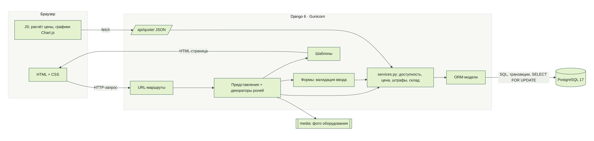
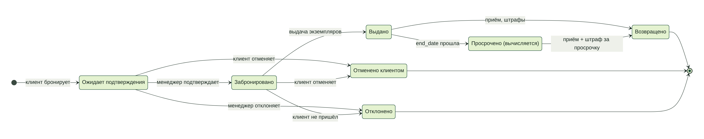
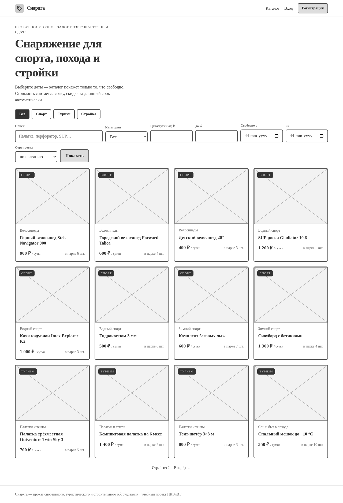
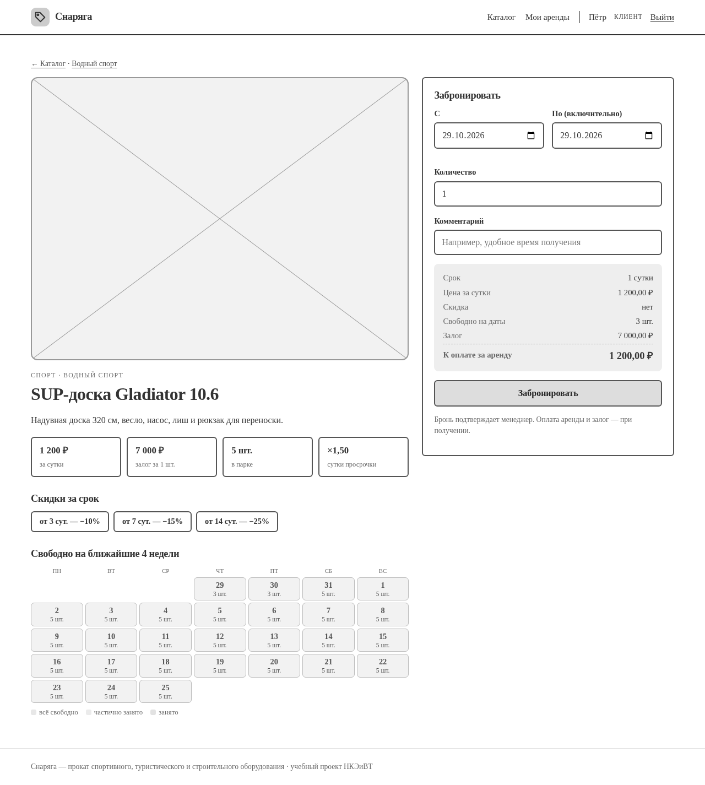
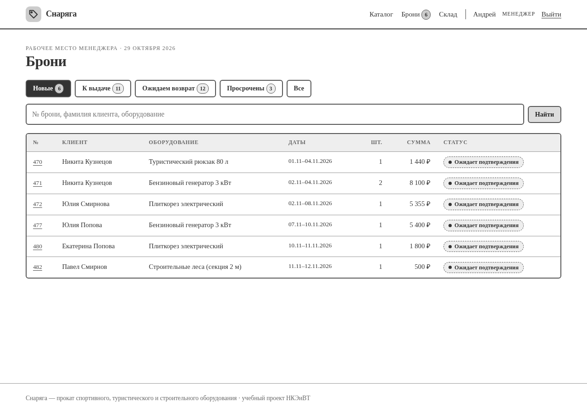
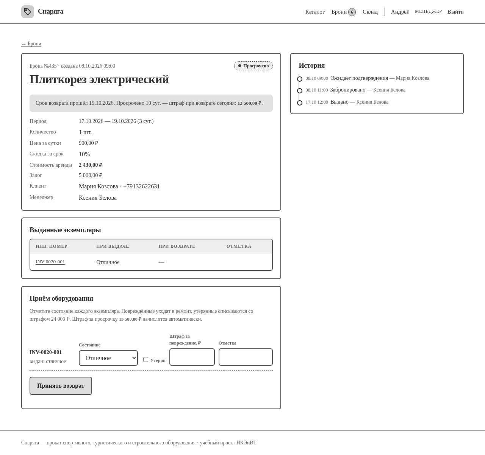
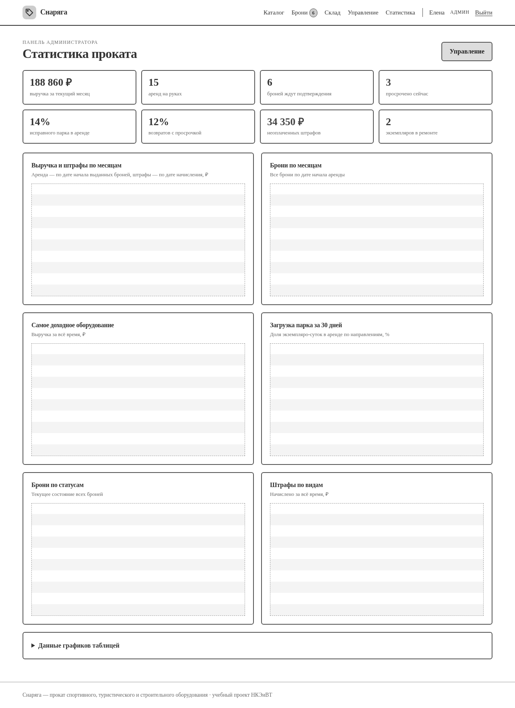

# 3. Архитектура

## 3.1. Стек

| Слой | Технология | Почему |
|---|---|---|
| Backend | Python 3.13+, Django 6.0 | Из рекомендованного стека; ORM, миграции, авторизация, формы с валидацией, защита от CSRF «из коробки» |
| Frontend | HTML (шаблоны Django), CSS, JavaScript | Серверный рендеринг без отдельного SPA; JS — меню, живой расчёт стоимости, графики |
| API | JSON-эндпоинт `/api/quote/` | Расчёт цены и доступности для формы бронирования; проверяется в Postman |
| Графики | Chart.js 4 | Столбчатые и линейные диаграммы со всплывающими подсказками |
| БД | PostgreSQL 17 (Docker, сервер), SQLite (быстрый локальный старт) | Переключение переменной `DB_NAME`; блокировки строк — в PostgreSQL |
| Запуск | Docker Compose, Gunicorn, WhiteNoise | Одна команда для запуска; статика без отдельного веб-сервера |
| Инструменты | Git, Postman, Mermaid (диаграммы), Playwright (скриншоты) | |

## 3.2. Структура

```
config/                     настройки, корневые URL
apps/
  accounts/                 пользователь с ролью, регистрация, вход, профиль, декораторы ролей
  catalog/                  категории, оборудование, скидки за срок, правила проката; каталог и /api/quote/
  inventory/                экземпляры (Unit) и журнал склада (UnitEvent)
    services.py             поступление, ремонт, списание, смена состояния
  bookings/                 брони, выданные экземпляры, штрафы, история статусов
    services.py             доступность, расчёт цены и штрафов, переходы статусов, выдача и приём
    management/commands/seed_demo.py   демо-данные
  dashboard/                панель администратора и статистика (stats.py)
templates/                  шаблоны страниц
static/                     CSS, JS, иконка
seed/photos/                фото для демо-данных (источники — CREDITS.md)
deploy/                     скрипты и конфигурация сервера
docs/                       документация, диаграммы, скриншоты, отчёт
```



Правила, которые меняют сразу несколько таблиц (бронь + история статусов, выдача + статусы экземпляров +
журнал склада, приём + штрафы + ремонт/списание), вынесены в `services.py` и выполняются в одной транзакции.
Представления только проверяют права, разбирают форму и вызывают сервис.

## 3.3. Защита от пересекающихся бронирований

1. **Форма** (`BookingForm.clean`) проверяет даты и считает `available_count` — пользователь сразу видит
   ошибку «На эти даты свободно только N шт.».
2. **Сервис** `create_booking` открывает транзакцию, блокирует строку оборудования
   (`Equipment.objects.select_for_update()`) и пересчитывает доступность **ещё раз**. Второй параллельный
   запрос на ту же позицию ждёт окончания первого и видит уже созданную бронь. Это проверено тестом с шестью
   одновременными потоками на PostgreSQL.
3. **Подтверждение** менеджером тоже пересчитывает доступность: за время ожидания экземпляры могли уйти в
   ремонт или на списание.
4. **Выдача** блокирует строки выбранных экземпляров и проверяет, что они ещё на складе.

Пересечение интервалов: `start_date ≤ конец_запроса И end_date ≥ начало_запроса` (обе границы включительно).
Выданная и не возвращённая вовремя бронь продолжает занимать экземпляры до сегодняшнего дня.

## 3.4. Роли и доступ

| Раздел | Гость | Клиент | Менеджер | Администратор |
|---|---|---|---|---|
| Каталог, карточка, `/api/quote/` | ✅ | ✅ | ✅ | ✅ |
| Бронирование, «Мои аренды», отмена | — | ✅ | — | — |
| Карточка брони | — | только свои | все | все |
| Рабочее место `/manager/`: подтверждение, выдача, приём, оплата штрафов | — | — | ✅ | ✅ |
| Склад: просмотр, ремонт, смена состояния | — | — | ✅ | ✅ |
| Склад: поступление и списание | — | — | — | ✅ |
| Панель `/panel/`: каталог, тарифы, сотрудники, клиенты, статистика | — | — | — | ✅ |

Проверка роли — декораторы `client_required`, `staff_required`, `admin_required`
(`apps/accounts/permissions.py`). Суперпользователь Django всегда считается администратором.

## 3.5. Схема статусов брони



Допустимые переходы заданы словарём `TRANSITIONS` в `apps/bookings/models.py`; любой другой переход сервис
отклоняет. Статус «Просрочено» не хранится в базе: это выданная бронь, у которой дата окончания уже прошла
(`Booking.is_overdue`). Поэтому не нужен планировщик, а статус всегда актуален на момент просмотра.

## 3.6. Маршруты

| URL | Назначение |
|---|---|
| `/` | Каталог |
| `/equipment/<id>/` | Карточка оборудования с формой брони |
| `/api/quote/?equipment=&start=&end=&qty=` | Расчёт стоимости и доступности (JSON) |
| `/accounts/register/`, `login/`, `logout/`, `profile/`, `home/` | Учётная запись; `home/` ведёт каждую роль на её стартовую страницу |
| `/equipment/<id>/book/` | Создание брони (POST) |
| `/my/` | Личный кабинет клиента |
| `/bookings/<id>/`, `/bookings/<id>/cancel/` | Карточка брони, отмена |
| `/manager/` | Рабочее место менеджера (вкладки `?tab=new|issue|returns|overdue|all`) |
| `/manager/<id>/confirm/`, `reject/`, `issue/`, `return/`, `/manager/fines/<id>/paid/` | Действия менеджера (POST) |
| `/stock/`, `/stock/units/`, `/stock/units/<id>/` и действия | Склад |
| `/panel/` | Статистика |
| `/panel/equipment/`, `categories/`, `tariffs/`, `staff/`, `users/` | Панель администратора |
| `/django-admin/` | Стандартная админка Django (резервный доступ) |

## 3.7. Макеты интерфейса

Перед вёрсткой были определены основные экраны и их блоки. Ниже — low-fi макеты (каркас без цвета и фото)
пяти ключевых экранов; цветной итоговый вид — в [руководстве пользователя](06-user-guide.md).

| Экран | Макет |
|---|---|
| Каталог: направления, фильтры, сетка карточек |  |
| Карточка оборудования: фото, факты, календарь, форма брони с расчётом |  |
| Рабочее место менеджера: вкладки-очереди, поиск, таблица |  |
| Карточка брони: данные, экземпляры, приём, история |  |
| Статистика: показатели и шесть графиков |  |

Визуальный стиль: «прокатная бирка» — тёмно-хвойный текст, меловой фон, сигнальный жёлто-зелёный акцент
как у светоотражающей ленты; номера, даты и суммы набраны моноширинным шрифтом. Поддерживается тёмная тема
системы.

## 3.8. Развёртывание

Приложение опубликовано на https://rental.37.194.184.235.sslip.io; схема и инструкции —
в [разделе 8](08-deployment.md).
