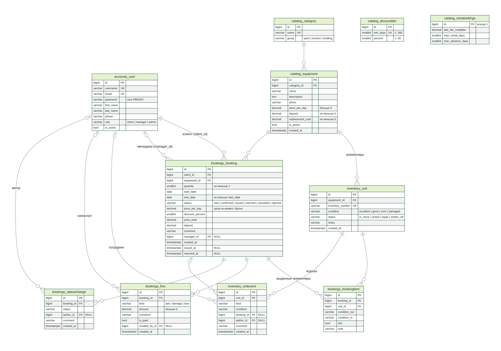
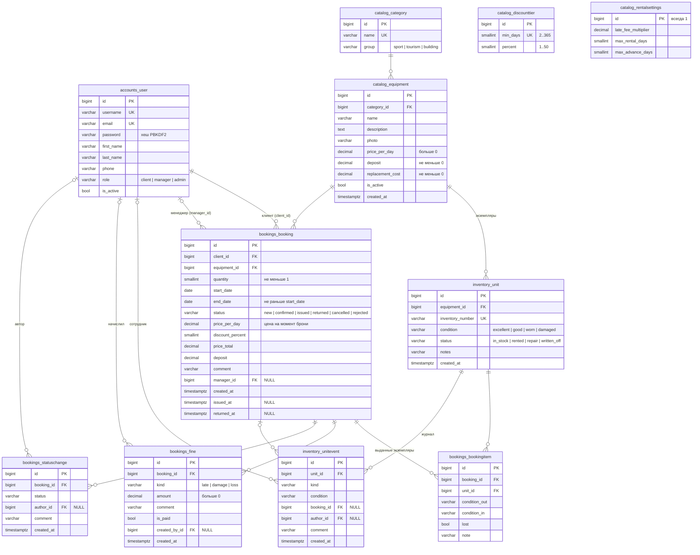

# 4. База данных

СУБД — PostgreSQL 17 (на сервере и в Docker), для быстрого локального запуска — SQLite. Схема создаётся
миграциями Django (`python manage.py migrate`); исходники моделей — `apps/*/models.py`.

## 4.1. ER-диаграмма

Исходник диаграммы (Mermaid, `docs/diagrams/er.mmd`):

## 4.2. Таблицы

### accounts_user — пользователи

Наследует стандартного пользователя Django (`AbstractUser`).

| Поле | Тип | Ограничения | Описание |
|---|---|---|---|
| id | bigint | PK | |
| username | varchar(150) | UNIQUE, NOT NULL | логин |
| email | varchar(254) | UNIQUE, NOT NULL | проверяется без учёта регистра в формах |
| password | varchar(128) | NOT NULL | хеш `pbkdf2_sha256$…`, сам пароль не хранится |
| first_name, last_name | varchar(150) | обязательны при регистрации | |
| phone | varchar(16) | 10–15 цифр, допускается «+» | |
| role | varchar(10) | `client` / `manager` / `admin`, по умолчанию `client` | роль в приложении |
| is_active | bool | | `false` — пользователь заблокирован, вход невозможен |

### catalog_category — категории

| Поле | Тип | Ограничения | Описание |
|---|---|---|---|
| id | bigint | PK | |
| name | varchar(80) | UNIQUE | «Велосипеды», «Палатки и тенты», … |
| group | varchar(10) | `sport` / `tourism` / `building` | направление проката |

### catalog_equipment — позиции каталога

| Поле | Тип | Ограничения | Описание |
|---|---|---|---|
| id | bigint | PK | |
| category_id | bigint | FK → catalog_category, ON DELETE PROTECT | категорию с оборудованием удалить нельзя |
| name, description | varchar(150), text | | |
| photo | varchar(100) | | путь к файлу в `media/equipment/` |
| price_per_day | numeric(10,2) | CHECK > 0 | цена за сутки |
| deposit | numeric(10,2) | CHECK ≥ 0 | залог за 1 шт. |
| replacement_cost | numeric(10,2) | CHECK ≥ 0 | штраф при утере |
| is_active | bool | | `false` — скрыто из каталога, бронировать нельзя |
| created_at | timestamptz | | |

### catalog_discounttier — скидки за срок (тарифы)

| Поле | Тип | Ограничения | Описание |
|---|---|---|---|
| min_days | smallint | UNIQUE, 2…365 | скидка действует от этого числа суток |
| percent | smallint | CHECK 1…50 | размер скидки |

### catalog_rentalsettings — правила проката

Ровно одна запись (`id = 1`, гарантируется методом `save`).

| Поле | Тип | По умолчанию | Описание |
|---|---|---|---|
| late_fee_multiplier | numeric(4,2) | 1,50 | сутки просрочки = цена суток × множитель, 1…10 |
| max_rental_days | smallint | 30 | максимальный срок одной брони |
| max_advance_days | smallint | 90 | насколько вперёд можно бронировать |

### inventory_unit — экземпляры

| Поле | Тип | Ограничения | Описание |
|---|---|---|---|
| id | bigint | PK | |
| equipment_id | bigint | FK → catalog_equipment, PROTECT | |
| inventory_number | varchar(30) | UNIQUE | `INV-<id оборудования>-<номер>` |
| condition | varchar(10) | `excellent` / `good` / `worn` / `damaged` | состояние |
| status | varchar(12) | `in_stock` / `rented` / `repair` / `written_off` | где находится |
| notes | varchar(255) | | |
| created_at | timestamptz | | дата поступления |

Индекс `(equipment_id, status)` — для подсчёта исправных экземпляров позиции.

### inventory_unitevent — журнал склада

| Поле | Тип | Ограничения | Описание |
|---|---|---|---|
| unit_id | bigint | FK → inventory_unit, CASCADE | |
| kind | varchar(12) | поступление / выдача / возврат / ремонт / из ремонта / списание / смена состояния | |
| condition | varchar(10) | | состояние на момент события |
| booking_id | bigint | FK → bookings_booking, SET NULL, NULL | бронь, если событие связано с арендой |
| author_id | bigint | FK → accounts_user, SET NULL | сотрудник |
| comment | varchar(255) | | причина списания, описание ремонта |
| created_at | timestamptz | | |

### bookings_booking — брони

| Поле | Тип | Ограничения | Описание |
|---|---|---|---|
| id | bigint | PK | номер брони |
| client_id | bigint | FK → accounts_user, PROTECT | |
| equipment_id | bigint | FK → catalog_equipment, PROTECT | |
| quantity | smallint | CHECK ≥ 1 | количество экземпляров |
| start_date, end_date | date | CHECK `end_date ≥ start_date` | обе даты включительно |
| status | varchar(10) | `new` / `confirmed` / `issued` / `returned` / `cancelled` / `rejected` | «просрочено» вычисляется |
| price_per_day | numeric(10,2) | | цена на момент брони |
| discount_percent | smallint | | скидка на момент брони |
| price_total | numeric(12,2) | CHECK ≥ 0 | стоимость аренды |
| deposit | numeric(12,2) | | залог за все экземпляры |
| comment | varchar(255) | | комментарий клиента |
| manager_id | bigint | FK → accounts_user, SET NULL, NULL | кто подтвердил/выдал |
| created_at, issued_at, returned_at | timestamptz | `issued_at`, `returned_at` NULL до события | |

Индекс `(equipment_id, status, start_date, end_date)` — для запроса пересечений.

### bookings_bookingitem — выданные экземпляры

| Поле | Тип | Ограничения | Описание |
|---|---|---|---|
| booking_id | bigint | FK → bookings_booking, CASCADE | |
| unit_id | bigint | FK → inventory_unit, PROTECT | |
| condition_out | varchar(10) | | состояние при выдаче |
| condition_in | varchar(10) | пусто до возврата | состояние при возврате |
| lost | bool | | экземпляр утерян |
| note | varchar(255) | | отметка менеджера |

UNIQUE `(booking_id, unit_id)` — один экземпляр не попадёт в бронь дважды.

### bookings_fine — штрафы

| Поле | Тип | Ограничения | Описание |
|---|---|---|---|
| booking_id | bigint | FK → bookings_booking, CASCADE | |
| kind | varchar(10) | `late` / `damage` / `loss` | просрочка / повреждение / утеря |
| amount | numeric(12,2) | CHECK > 0 | |
| comment | varchar(255) | | основание: расчёт просрочки, номер экземпляра |
| is_paid | bool | | отметка об оплате |
| created_by_id | bigint | FK → accounts_user, SET NULL | |
| created_at | timestamptz | | |

### bookings_statuschange — история статусов

| Поле | Тип | Описание |
|---|---|---|
| booking_id | FK → bookings_booking, CASCADE | |
| status | varchar(10) | новый статус |
| author_id | FK → accounts_user, SET NULL | кто перевёл |
| comment | varchar(255) | причина отказа и т. п. |
| created_at | timestamptz | |

## 4.3. Ограничения целостности

| Где | Ограничение | Зачем |
|---|---|---|
| catalog_equipment | `equipment_price_positive`, `equipment_deposit_non_negative`, `equipment_replacement_non_negative` | цены не могут быть отрицательными даже при записи в обход форм |
| catalog_discounttier | `tier_percent_range` (1…50), UNIQUE `min_days` | не больше одной скидки на срок |
| bookings_booking | `booking_dates_order`, `booking_quantity_positive`, `booking_total_non_negative` | бронь с перепутанными датами или нулевым количеством невозможна |
| bookings_bookingitem | `booking_unit_unique` | один экземпляр — одна строка в брони |
| bookings_fine | `fine_amount_positive` | штраф всегда положительный |
| accounts_user | UNIQUE `username`, `email` | |
| inventory_unit | UNIQUE `inventory_number` | |
| Внешние ключи | `PROTECT` для клиента, оборудования и экземпляров | нельзя удалить то, на что ссылаются брони и история |

Ограничение «не больше N экземпляров на пересекающиеся даты» нельзя выразить простым `CHECK`, поэтому оно
обеспечивается сервисным слоем внутри транзакции с блокировкой строки оборудования (раздел
[3.3](03-architecture.md#33-защита-от-пересекающихся-бронирований)).

## 4.4. Демо-данные

`python manage.py seed_demo` заполняет пустую базу: 8 категорий в трёх направлениях, 23 позиции с фото,
116 экземпляров, 3 сотрудника, 29 клиентов, около 480 броней за последний год во всех статусах (включая
просроченные), штрафы всех видов, экземпляры в ремонте и списанный экземпляр. Доступность при генерации
проверяется тем же `available_count`, что и на сайте, поэтому демо-брони не пересекаются сверх парка.
