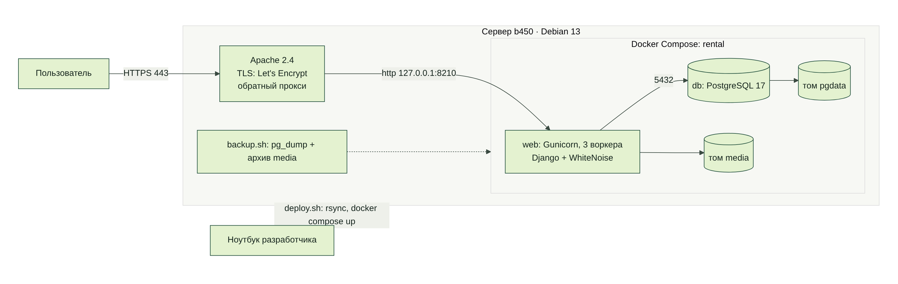

# 8. Развёртывание и сопровождение

## 8.1. Схема



| Компонент | Где | Детали |
|---|---|---|
| Сервер | `b450`, Debian 13, Docker | SSH-алиас `b450-remote` |
| Каталог стека | `~/rental` | `docker-compose.yml`, `.env`, `src/`, `backup.sh`, `apache-rental.conf` |
| Приложение | контейнер `rental-web-1` | Gunicorn, 3 процесса, слушает только `127.0.0.1:8210` |
| БД | контейнер `rental-db-1` | PostgreSQL 17, порт наружу не открыт, том `rental_pgdata` |
| Фото | том `rental_media` | смонтирован в `/app/media` |
| Веб-сервер | Apache 2.4 | `zz-rental.conf` и `zz-rental-le-ssl.conf`, обратный прокси, лимит тела запроса 10 МБ |
| Домен | https://rental.37.194.184.235.sslip.io | сертификат Let's Encrypt, HTTP перенаправляется на HTTPS |

На сервере работают и другие сервисы. Стек изолирован в отдельном проекте Compose `rental` и не публикует
порты на внешний интерфейс.

## 8.2. Требования

- Сервер: Linux, Docker Engine 24+ с плагином `docker compose`, Apache 2.4 с модулями `proxy`, `proxy_http`,
  `headers`, `ssl`, certbot.
- Машина разработчика: `ssh`, `rsync`, доступ к серверу по ключу.

## 8.3. Первая установка

1. Скопировать код и запустить стек (при первом запуске создаётся `~/rental/.env` со случайными
   `SECRET_KEY` и `DB_PASSWORD`):

   ```sh
   deploy/deploy.sh b450-remote                 # [каталог] [домен] — необязательные аргументы
   ```

2. Подключить Apache и выпустить сертификат (на сервере, от root):

   ```sh
   sudo cp ~/rental/apache-rental.conf /etc/apache2/sites-available/zz-rental.conf
   sudo a2ensite zz-rental && sudo apache2ctl configtest && sudo systemctl reload apache2
   sudo /snap/bin/certbot --apache -d rental.37.194.184.235.sslip.io
   ```

3. Создать администратора **или** загрузить демо-данные:

   ```sh
   ssh b450-remote 'cd rental && docker compose exec web python manage.py createsuperuser'
   ssh b450-remote 'cd rental && docker compose exec -T web python manage.py seed_demo --password <пароль>'
   ```

Миграции применяются автоматически при каждом старте контейнера `web`.

## 8.4. Обновление

```sh
.venv/bin/python manage.py test   # тесты зелёные — можно выкладывать
deploy/deploy.sh b450-remote      # rsync кода, пересборка образа, перезапуск web
```

Простой — несколько секунд, пока перезапускается контейнер `web`. База и фото лежат в томах и не
затрагиваются.

## 8.5. Резервное копирование и восстановление

```sh
ssh b450-remote 'cd rental && ./backup.sh'   # дамп БД + архив фото в ~/rental/backups, хранятся 14 последних
```

Ежедневный бэкап — строка в `crontab -e` на сервере:

```
40 3 * * * cd $HOME/rental && ./backup.sh >> backups/backup.log 2>&1
```

Восстановление (останавливает приложение, база заменяется целиком):

```sh
cd ~/rental
docker compose stop web
docker compose exec -T db pg_restore -U rental -d rental --clean --if-exists < backups/db_<дата>.dump
docker compose run --rm -T web tar -C /app -xzf - < backups/media_<дата>.tar.gz
docker compose start web
```

## 8.6. Диагностика

| Что проверить | Команда |
|---|---|
| Состояние контейнеров | `ssh b450-remote 'cd rental && docker compose ps'` |
| Логи приложения | `ssh b450-remote 'cd rental && docker compose logs --tail 100 web'` |
| Ответ приложения в обход Apache | `ssh b450-remote 'curl -sI -H "Host: rental.37.194.184.235.sslip.io" http://127.0.0.1:8210/'` |
| Логи Apache | `/var/log/apache2/rental-error.log`, `rental-access.log` |
| Срок сертификата | `sudo /snap/bin/certbot certificates` (certbot стоит через snap, `/snap/bin` нет в `secure_path` у sudo) |

| Симптом | Причина и решение |
|---|---|
| 400 Bad Request | домен не входит в `ALLOWED_HOSTS` — проверить `DOMAIN` в `~/rental/.env` |
| 403 CSRF при входе | открыто по HTTP или с другого домена; вход работает только по HTTPS на домене из `DOMAIN` |
| 413 при загрузке фото | превышен `LimitRequestBody` в Apache (10 МБ) |
| 502 Bad Gateway | контейнер `web` не запущен — смотреть `docker compose logs web` |

## 8.7. Локальный запуск

См. [README](../README.md): SQLite и `runserver` для разработки или `docker compose up` из корня репозитория
для проверки с PostgreSQL (порты 8200 и 5435).
